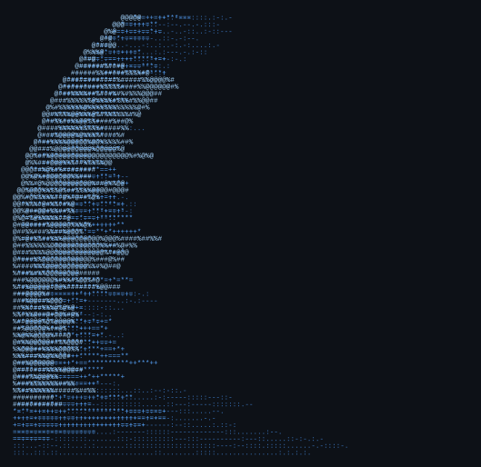

**Varsha Lalam** &nbsp;·&nbsp; <samp>It Project Manager · Pharma & Lifescience delivery</samp>

*Keeping DEV, QA, and Ops moving in the same direction so nothing falls through the cracks*

[Linkedin](https://www.linkedin.com/in/varsha-lalam-92b243175) &nbsp;·&nbsp; [Email](mailto:varsha.ashis@gmail.com)

<blockquote>
IT Project Manager and Release Delivery professional with 10 years in regulated pharmaceutical environments. Structure and transparency are not overhead, they are how delivery actually works.
</blockquote>

Currently moving from in-house pharma IT delivery into enterprise software consulting, with a focus on GxP-compliant system implementations in life sciences. At Optel Group, I owned the full release 
lifecycle of [serialization middleware](https://github.com/varshaashis-blip) for global pharma clients across EMEA and APAC. PRINCE2® Agile Practitioner certified, and now deepening my work in validation frameworks and SaaS delivery in regulated environments.

**[Serialization Middleware Delivery, Optel Group](https://github.com/varshaashis-blip)** &nbsp;·&nbsp; < samp> Python, PowerShell, YAML, JIRA, Confluence, Servicenow</samp> 
End-to-end release management for GxP-compliant serialization middleware across global pharma clients. 30+ governed production releases, zero major post-release incidents in five years.

**[Data Integration Pipeline, EMICO Norway](https://github.com/varshaashis-blip)** &nbsp;·&nbsp; <samp>Mulesoft, Oracle, SQL, XML, CSV</samp> 
Automated data infrastructure integration for a Norway-based procurement platform, enabling near-real-time reporting across cross-timezone stakeholder teams.

## 💻 Tech Stack

             

## 📊 GitHub Stats

 
 

## 🏆 GitHub Trophies

---

